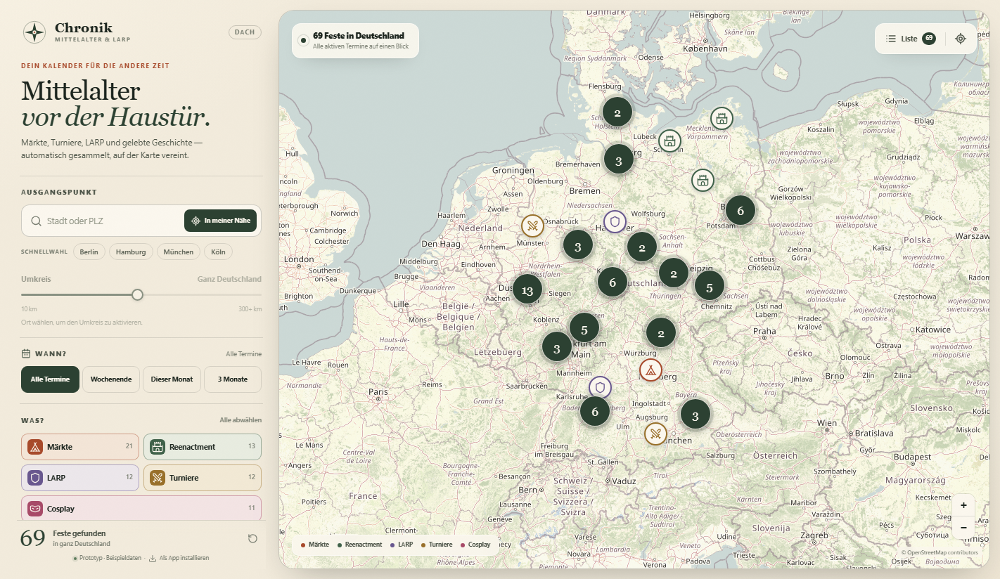
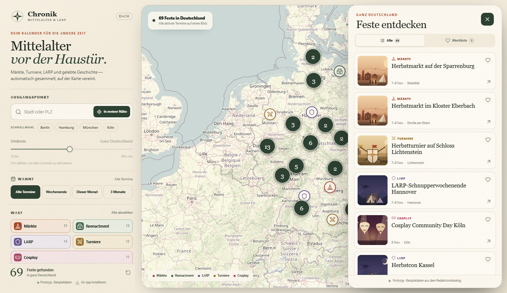
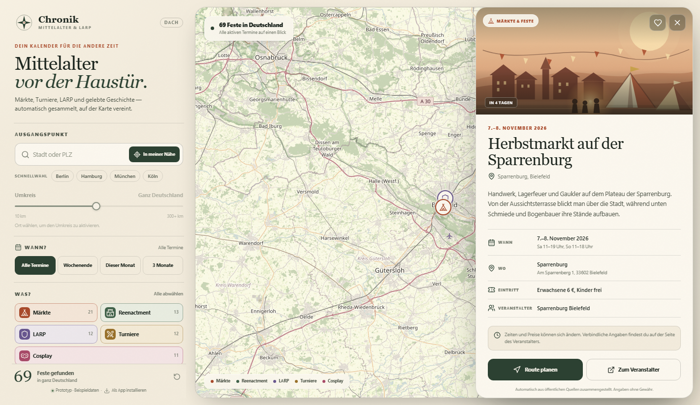
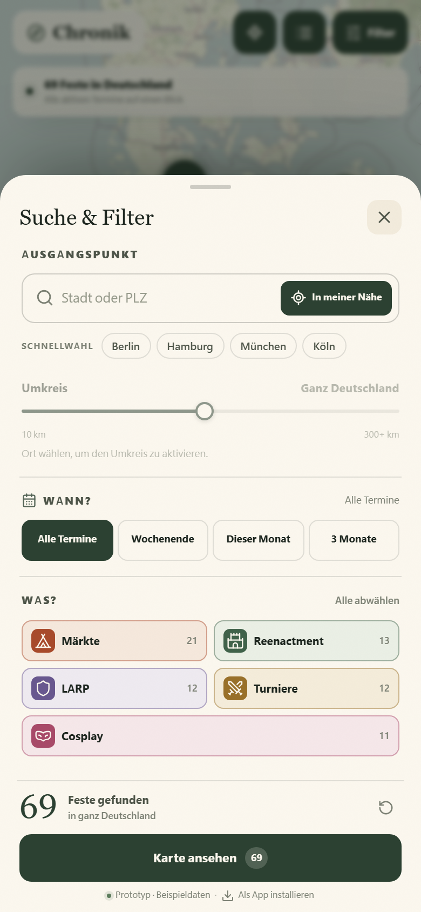
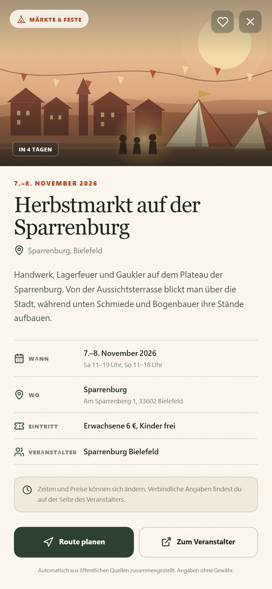

# Chronik

**Автоматический веб-агрегатор средневековых мероприятий, LARP и реконструкции для Германии и DACH.**
Интерактивная карта, радиусный поиск, маршрут в один клик и полностью автономный конвейер сбора данных.

> Прототип готов к демонстрации: 69 мероприятий, карта с кластеризацией, фильтры, карточки, PWA и работающий Python-пайплайн. Данные в интерфейсе — редакционные примеры; боевой каталог наполняется скрапером.

---

## Что уже реализовано

**Пользовательский интерфейс**
- Полноэкранная карта OpenStreetMap + Leaflet с кластеризацией маркеров.
- Цветовые категории: ярмарки, реконструкция, LARP, турниры/бои, косплей.
- Геолокация «In meiner Nähe», поиск по городу и почтовому индексу (119 городов DACH).
- Ползунок радиуса 10–300+ км с мгновенным пересчётом по формуле гаверсинусов.
- Фильтры по датам: все, выходные, текущий месяц, ближайшие 90 дней.
- Список событий, избранное (localStorage), карточка события.
- Прокладка маршрута: Google Maps на Android/desktop, Apple Maps на iOS.
- Кнопка перехода на сайт организатора, телефон/планшет/desktop.
- PWA: manifest, service worker, установка на домашний экран, офлайн-оболочка.
- Дизайн-система на локальных шрифтах Fraunces + Manrope (без внешних CDN).

**Данные и бэкенд**
- Python-пайплайн: `sources.json → scraper → AI-нормализация → Nominatim → дедупликация → Supabase`.
- Эвристический fallback без OpenAI: даты, адреса, города, цены, часы работы.
- Уважение `robots.txt`, лимит 1 запрос/сек на домен, таймауты, ретраи, дисковый кэш страниц.
- Nominatim: кэш геокодов, задержка 1,1 с, fallback на координаты города.
- Дедупликация по расстоянию, пересечению дат и похожести названий; слияние дублей.
- Supabase/PostgreSQL + PostGIS: RLS, read-model `active_events`, RPC `events_near`, автоархивация.
- GitHub Actions: ежедневный запуск, ручной запуск, артефакты и журнал прогонов.
- 20 unit-тестов пайплайна, парсер дат и дедупликации.

---

## Скриншоты

| Карта | Список событий |
| --- | --- |
|  |  |

| Карточка события | Мобильные фильтры |
| --- | --- |
|  |  |



---

## Стек

| Слой | Технологии |
| --- | --- |
| Frontend | React 19, TypeScript, Vite 6, Leaflet 1.9, leaflet.markercluster |
| Карта | OpenStreetMap tiles, Leaflet, кастомные SVG-маркеры и сцены |
| PWA | Web App Manifest, service worker, локальные WOFF2 |
| Backend | Python 3.11+, lxml, stdlib HTTP |
| AI | OpenAI Chat Completions (`gpt-4o-mini` по умолчанию) |
| Геокодинг | OpenStreetMap Nominatim |
| База | Supabase / PostgreSQL 15 + PostGIS + pg_trgm |
| Автозапуск | GitHub Actions (ежедневно), опционально pg_cron |

---

## Быстрый старт

Требования: Node.js 20+, npm (или pnpm), Python 3.11+.

```bash
cd chronik
npm install

# демо-режим: 69 мероприятий из src/data/events.ts
npm run dev
# http://127.0.0.1:5173

# production-сборка
npm run build
npm run preview
```

Если Vite в вашем окружении не может запустить esbuild-сервис (например, строгая песочница), есть эквивалентная статическая сборка:

```bash
npm run build:static
npm run serve
# http://127.0.0.1:4173
```

### Подключение живых данных Supabase

1. Создайте проект Supabase.
2. Выполните `supabase/schema.sql` в SQL Editor.
3. Создайте `.env` по образцу `.env.example`:

```env
VITE_SUPABASE_URL=https://YOUR_PROJECT.supabase.co
VITE_SUPABASE_ANON_KEY=YOUR_ANON_KEY
```

4. Перезапустите `npm run dev`. Фронтенд читает публичное представление `active_events`. Если переменные не заданы или база пуста, приложение автоматически остаётся на демо-каталоге и честно показывает «Prototyp · Beispieldaten».

> Anon key предназначен для браузера. Запись закрыта RLS; collector использует service-role key только на сервере.

---

## Архитектура

```text
sources.json
   │
   ▼
Fetcher ── robots.txt, rate limit, retry, cache ──► HTML
   │
   ▼
Парсер страницы (lxml) ── заголовок, абзацы, ссылки
   │
   ├── OpenAI JSON-экстракция (основной путь)
   └── эвристический fallback (без ключа/при сбое)
   │
   ▼
Nominatim (кэш + 1 req/s) ── fallback: координаты города
   │
   ▼
Дедупликация ── расстояние + даты + схожесть названий
   │
   ├── backend/data/events.json (dry-run/артефакт)
   └── Supabase.upsert → active_events → PWA
                         └── archive_past_events()
```

### Модель данных

`events` хранит нормализованное событие: категорию, даты, часы работы, адрес, `lat/lng`, `location geography(Point,4326)`, описание, организатора, цену, источник и confidence.

- `active_events` — публичное представление: только `status='active'` и `end_date >= current_date`.
- `events_near(lat, lng, radius_km, categories, from, to)` — радиусный поиск через `ST_DWithin`.
- `archive_past_events()` — переводит прошедшие события в `archived`.
- `crawl_runs` — журнал запусков коллектора.
- RLS: анонимный пользователь читает только активные события; запись — только service role.

---

## Коллектор

### Установка

```bash
python -m venv .venv
# Windows: .venv\Scripts\activate
# macOS/Linux: source .venv/bin/activate
pip install -r backend/requirements.txt
```

### Офлайн-демо на фикстурах (без ключей и сети)

```bash
python -m backend.pipeline \
  --offline --no-ai --no-geocode \
  --fixture-dir backend/fixtures \
  --sources burg-ronneburg,burg-satzvey,mps-spectaculum \
  --out backend/data/events.json
```

Команда извлекает события, определяет город, ставит координаты по городскому справочнику, дедуплицирует и пишет JSON. Полезно для проверки пайплайна и CI.

### Боевой запуск

```bash
cp .env.example .env
# заполните OPENAI_API_KEY, SUPABASE_URL, SUPABASE_SERVICE_ROLE_KEY, CONTACT_EMAIL

python -m backend.pipeline --publish
```

Флаги:

| Флаг | Значение |
| --- | --- |
| `--sources a,b` | только выбранные источники |
| `--limit N` | ограничить число источников |
| `--fixture-dir DIR` | читать локальные HTML вместо сети |
| `--offline` | запретить сеть |
| `--no-ai` | только эвристика |
| `--no-geocode` | без Nominatim, координаты города |
| `--publish` | upsert в Supabase + автоархивация |
| `--out PATH` | путь JSON-выгрузки |
| `--today YYYY-MM-DD` | фиксированная дата для тестов |

### Как работает извлечение

1. **Скрапинг.** `backend/http.py` скачивает страницу с User-Agent `ChronikBot`, соблюдает `robots.txt`, ограничивает размер и частоту запросов, кэширует HTML в `.cache/pages`.
2. **Нормализация.** `backend/extractor.py` отправляет текст в OpenAI с промптом, запрещающим выдумывать данные. Ответ — строгий JSON. При отсутствии ключа или ошибке API включается эвристика: немецкие даты, адреса, ZIP, города, цена, часы работы.
3. **Геокодинг.** `backend/geocoder.py` обращается к Nominatim не чаще 1 раза в секунду, кэширует результаты, при сбое ставит координаты центра города.
4. **Дедупликация.** `backend/dedupe.py` сравнивает расстояние (гаверсинус), пересечение дат и похожесть названий; объединяет источники и выбирает более полное описание.
5. **Публикация.** `backend/storage.py` делает upsert по `dedupe_key`, архивирует прошедшие события и пишет `crawl_runs`.

### Источники

Каталог — `backend/sources.json` (14 площадок): MPS Spectaculum, Burg Satzvey, Burg Ronneburg, Kaltenberg, Landshuter Hochzeit, Drachenfest, Epic Empires, ConQuest of Myths, DoKomi, AnimagiC, Mittelaltermarkt.de, LARP-Kalender, Wartburg, Burg Altena.

Чтобы добавить источник, добавьте объект:

```json
{
  "slug": "mein-veranstalter",
  "name": "Mein Veranstalter",
  "url": "https://example.de/termine",
  "category": "markt",
  "max_pages": 2
}
```

Категории: `markt`, `reenactment`, `larp`, `turnier`, `cosplay`. Для фикстур укажите `"fixture": "mein-veranstalter.html"`.

---

## Supabase

1. **SQL Editor** → выполнить `supabase/schema.sql`.
2. **Project Settings → API** → взять `Project URL` и `anon public key` для фронтенда, `service_role` — только для GitHub Actions.
3. Вставить события:

```bash
python -m backend.pipeline --publish --sources burg-ronneburg,burg-satzvey
```

4. Проверить RPC:

```bash
curl -X POST "$SUPABASE_URL/rest/v1/rpc/events_near" \
  -H "apikey: $SUPABASE_ANON_KEY" \
  -H "Authorization: Bearer $SUPABASE_ANON_KEY" \
  -H "Content-Type: application/json" \
  -d '{"p_lat":50.11,"p_lng":8.68,"p_radius_km":150,"p_categories":["markt","larp"]}'
```

### Автоархивация

`archive_past_events()` вызывается пайплайном после каждого upsert. Дополнительно можно включить pg_cron (закомментировано в конце `schema.sql`):

```sql
select cron.schedule('archive-past-events', '15 3 * * *', $$select public.archive_past_events();$$);
```

---

## Деплой

### GitHub Pages (статический сайт и PWA)

Проект уже подготовлен к GitHub Pages, включая проектные страницы вида `https://user.github.io/repo/`.

1. Создайте репозиторий и положите **содержимое папки `chronik/` в корень репозитория** (там, где лежат `package.json`, `src/`, `backend/`).
2. В GitHub откройте **Settings → Pages → Build and deployment → Source: GitHub Actions**.
3. Отправьте изменения в ветку `main`. Workflow [pages.yml](.github/workflows/pages.yml) соберёт `dist/` и опубликует его.
4. Сайт будет доступен по адресу `https://<user>.github.io/<repo>/` (или `https://<user>.github.io/` для user-site репозитория).
5. Для живых данных Supabase добавьте **Settings → Secrets and variables → Actions → Variables**:
   - `VITE_SUPABASE_URL`
   - `VITE_SUPABASE_ANON_KEY`

   Anon key публичен по замыслу; защита записи обеспечивается RLS. **Не добавляйте `SUPABASE_SERVICE_ROLE_KEY` во frontend или Variables** — он нужен только collector-workflow как Secret.

Сборка использует относительные пути (`./assets`, `./icons`, `./fonts`) и `404.html`, поэтому работает и в корне домена, и в подпапке репозитория. Service worker автоматически определяет scope страницы. Никакой сервер для просмотра не нужен: карта, PWA и запросы к Supabase выполняются в браузере.

GitHub Pages — только статика. Коллектор запускается отдельно через [collect.yml](.github/workflows/collect.yml) по расписанию и пишет в Supabase. Для приватного репозитория доступность Pages зависит от тарифа GitHub.

### Frontend на Vercel / Netlify / Cloudflare Pages

Vercel / Netlify / Cloudflare Pages:

- Build command: `npm run build`
- Output: `dist`
- Env: `VITE_SUPABASE_URL`, `VITE_SUPABASE_ANON_KEY`
- Node 20+

### Collector

GitHub Actions уже настроен: `.github/workflows/collect.yml`, ежедневно в 04:15 UTC и вручную через **Run workflow**.

Secrets:

| Secret | Назначение |
| --- | --- |
| `OPENAI_API_KEY` | AI-нормализация |
| `SUPABASE_URL` | проект Supabase |
| `SUPABASE_SERVICE_ROLE_KEY` | запись в events/crawl_runs |
| `CONTACT_EMAIL` | контакт в User-Agent и Nominatim |

Без `OPENAI_API_KEY` пайплайн продолжит работу на эвристике, но точность будет ниже. Без Supabase-ключей запуск с `--publish` завершится понятной ошибкой.

### Карта и геокодинг в production

- Демо использует стандартные тайлы `tile.openstreetmap.org`. Для высокого трафика подключите tile CDN (MapTiler, Stadia, Thunderforest) или собственный сервер и обновите `MapView.tsx`.
- Nominatim public API имеет лимит 1 req/s и запрещает автодополнение. Для масштабирования — self-hosted Nominatim или Photon, либо прокси с кэшем.
- OpenAI-вызовы батчируются по страницам; для снижения расходов можно оставить эвристику для простых календарей и включать AI только для сложных.

---

## Тесты и качество

```bash
# Python: 20 тестов
python -m unittest discover -s backend/tests -v

# TypeScript
npm run typecheck

# Production build
npm run build
```

Проверено вручную в Chromium: desktop 1440×900, mobile 390×844; фильтры, радиус, поиск, кластеризация, избранное, карточка, маршрут, установка PWA.

---

## Структура

```text
chronik/
├── src/
│   ├── App.tsx                 # состояние фильтров, композиция экранов
│   ├── components/             # карта, панели, карточки, SVG-сцены
│   ├── data/                   # демо-каталог, категории, города
│   ├── lib/                    # haversine, даты, Supabase REST, маршруты
│   └── styles.css              # дизайн-система и адаптивность
├── public/                     # manifest, sw.js, шрифты, иконки
├── backend/
│   ├── pipeline.py             # CLI и оркестрация
│   ├── http.py                 # robots/retry/cache
│   ├── scraper.py              # HTML → PageContent
│   ├── extractor.py            # OpenAI + эвристика
│   ├── geocoder.py             # Nominatim + fallback
│   ├── dedupe.py               # нечёткая дедупликация
│   ├── storage.py              # Supabase upsert / JSON
│   ├── sources.json            # каталог источников
│   ├── fixtures/               # офлайн-примеры страниц
│   └── tests/                  # unittest
├── supabase/schema.sql         # PostGIS, RLS, RPC, архив
├── .github/workflows/
│   ├── collect.yml             # ежедневный сбор
│   └── pages.yml               # деплой PWA на GitHub Pages
└── docs/screenshots/
```

---

## Соответствие ТЗ

| Этап ТЗ | Статус | Реализация |
| --- | --- | --- |
| Проектирование интерфейса | ✅ | дизайн-система, карта, панель, карточка, адаптив |
| Бэкенд и парсер | ✅ | Python-пайплайн, 14 источников, AI + fallback |
| База и гео-поиск | ✅ | PostGIS, `active_events`, `events_near`, RLS |
| Фронтенд | ✅ | Leaflet, радиус, маршрут, PWA, избранное |
| Тестирование и запуск | ✅ / ⏭ | 20 тестов, ручная проверка; нужен production-мониторинг |

### Что сознательно не входит в прототип

- Модераторская панель и ручное редактирование (по ТЗ режим 100% автономный).
- Пользовательские аккаунты: избранное хранится локально.
- Платная картография и собственный Nominatim.
- Полноценный юридический аудит источников; перед публичным запуском проверьте ToS и согласие на перепубликацию описаний/фото.
- Извлечение баннерных фото: в интерфейсе используются собственные SVG-сцены, чтобы не нарушать авторские права и не зависеть от внешних CDN.

---

## Лицензия и этика

Код — для демонстрации и дальнейшей разработки. При работе коллектора:

- соблюдайте `robots.txt` и условия сайтов;
- не снижайте нагрузку на источники (1 req/s на домен);
- указывайте ссылку на организатора;
- не публикуйте персональные данные;
- проверяйте точность дат и адресов перед боевым запуском.

Контакты для вопросов и предложений: `hello@chronik.events`.


## Collection without AI (current deployment)
GitHub Pages rebuilds daily at 04:15 UTC. The build runs `python -m backend.pipeline --no-ai --out public/events.json`. No API key or Supabase account is required. Verified adapters: Burg Satzvey schema.org events and LARP-Kalender listing rows (50 newest entries). Other sources are disabled pending adapter validation. All category filters remain available. Postal-code locations are approximate and routing is disabled for these entries. Zero-result collection fails instead of replacing the last published catalogue.


### Expanded source coverage
The active adapters now cover six independently fetched sources:
- Burg Satzvey: schema.org events; dinner, seminars, workshops and readings are excluded.
- LARP-Kalender: the 50 newest listing entries.
- Sündenfrei: dated tour calendar rows; starred, cancelled and unconfirmed entries are excluded.
- Mittelalterkalender: the current table of upcoming events, with separate start/end dates and detail URLs.
- DoKomi: official announced date range, venue and published coordinates.
- AnimagiC: official convention date announcement and Rosengarten Mannheim venue.

Categories are determined from explicit names (tournaments, cosplay, reenactment), with a source-specific fallback. Calendar sources cover the entries currently published on their fetched pages; this is not an exhaustive inventory of Germany. Category filters can still be empty for a selected date or radius. `summary.source_counts` records extraction counts before expired entries and duplicates are removed. City/ZIP locations are approximate; directions are disabled for those records. Source detail links may lead to a calendar rather than the organizer.


### User-supplied source list
All 11 supplied sites have been checked. Eight are active (some via current canonical/official date pages); HistoFaber and History Event returned HTTP 503, and Vehi Mercatus returned HTTP 401, so they remain registered but disabled. Together with Burg Satzvey, DoKomi and AnimagiC, there are 11 active sources. See [source status and coverage](docs/sources.md) for validated URLs and limits.
